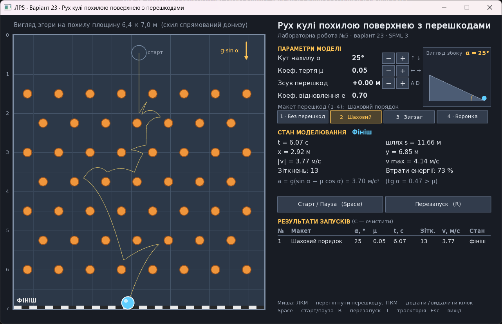

# SFML_Lab — рух кулі похилою поверхнею з перешкодами

Лабораторна робота №5 з дисципліни «Технології прикладного програмування»
(ДТЕУ, ФІТ, група ФІТ 3-9). **Варіант 23.**
Виконав: Силін Єгор.

Тема: використання бібліотеки **SFML** у C++-проєкті, система збирання **CMake**
і пакетний менеджер **vcpkg** (режим маніфесту).



## Що моделює програма

Куля радіусом 0,15 м скочується похилою площиною 6,4 × 7,0 м, нахиленою під кутом α.
На площині розташовані перешкоди: круглі кілки та похилі бортики.
У вікні показано вигляд площини згори (схил спрямований донизу), маленьку
схему «вигляд збоку» з кутом α, траєкторію та вектор швидкості кулі,
поточні параметри моделі й таблицю результатів запусків.

Фізична модель (куля розглядається як матеріальна точка, що ковзає площиною):

| Величина | Формула |
|---|---|
| складова сили тяжіння вздовж схилу | a<sub>g</sub> = g·sin α |
| прискорення від сили тертя (проти швидкості) | a<sub>тр</sub> = μ·g·cos α |
| прискорення без зіткнень | a = g(sin α − μ cos α) |
| умова початку руху | tg α > μ |
| зіткнення з перешкодою | v′ = v − (1 + e)(v·n)n |
| чисельний метод (напівнеявний Ейлер, Δt = 1/240 с) | v<sub>n+1</sub> = v<sub>n</sub> + a·Δt, r<sub>n+1</sub> = r<sub>n</sub> + v<sub>n+1</sub>·Δt |

Тут n — одинична нормаль від перешкоди до центра кулі, e = 0,7 — коефіцієнт відновлення.
Реальний час кадру `dt` береться з `sf::Clock` і накопичується, а модель
оновлюється рівними кроками 1/240 с, тому результат не залежить від частоти кадрів.

## Керування

| Клавіша / дія | Що робить |
|---|---|
| Space або кнопка «Старт / Пауза» | запуск, призупинення, продовження; після фінішу — новий запуск |
| R або кнопка «Перезапуск» | повернути кулю на старт |
| ↑ / ↓ або кнопки −/+ | кут нахилу α (0…60°, крок 1°) |
| → / ← або кнопки −/+ | коефіцієнт тертя μ (0…1, крок 0,01) |
| A / D або кнопки −/+ | зсунути всі перешкоди вліво / вправо на 0,05 м |
| 1 – 4 або кнопки макетів | макет перешкод: без перешкод, шаховий порядок, зигзаг, воронка |
| ЛКМ на перешкоді | перетягнути перешкоду |
| ПКМ | на порожньому місці — додати кілок, на перешкоді — видалити |
| T | показати / сховати траєкторію |
| C | очистити таблицю результатів |
| Esc | вихід |

## Структура проєкту

```
SFML_Lab/
├── CMakeLists.txt        # опис збирання
├── CMakePresets.json     # пресет default з toolchain-файлом vcpkg
├── vcpkg.json            # маніфест залежностей (sfml) + builtin-baseline
├── main.cpp              # вікно SFML: handleInput / updatePhysics / drawScene
├── physics.h, physics.cpp# фізична модель (без залежності від SFML)
├── experiment.cpp        # обчислювальний експеримент (--experiment)
├── resources/fonts/      # шрифт DejaVu Sans (кирилиця)
├── docs/                 # скріншоти, результати експерименту, журнал збирання
├── tools/                # скрипт збирання та знімання скріншотів
└── RUN_ME.bat            # запуск скрипта з tools/
```

Папка `build/` створюється CMake автоматично і до репозиторію не входить.

## Збирання

Потрібно: Visual Studio 2022/2026 (або Build Tools) з компонентами
«Desktop development with C++», «C++ CMake tools» і **vcpkg package manager**.
Змінна `VCPKG_ROOT` встановлюється середовищем розробника Visual Studio.

1. Один раз у папці проєкту (Developer PowerShell / Developer Command Prompt):
   ```
   vcpkg x-update-baseline --add-initial-baseline
   ```
   (у `vcpkg.json` з’являється поле `builtin-baseline`).
   > У проєкті baseline зафіксовано на реліз каталогу vcpkg **2025.10.17** (коміт `74e6536…`, SFML 3.0.2).
   > Найновіший baseline, який записує `x-update-baseline`, не сумісний із vcpkg, вбудованим у
   > Visual Studio 2026 Build Tools (версія 2025-09-03): збирання порту `wepoll` завершується помилкою
   > `Operation REMOVE_DUPLICATES not recognized`. Baseline не повинен бути новішим за сам vcpkg.
2. Visual Studio: **File → Open → Folder…** → вибрати `SFML_Lab`.
   CMake сконфігурує проєкт, vcpkg встановить SFML (`-- Running vcpkg install`, `-- Found SFML 3.0.2`).
   Потім **Build → Build All** і запуск цілі `SFML_Lab`.
3. Або з командного рядка:
   ```
   cmake --preset default
   cmake --build --preset default
   build\Debug\SFML_Lab.exe
   ```
4. Або просто запустити `RUN_ME.bat`: він збирає проєкт, виконує експеримент
   і робить скріншоти у `docs/screenshots` (`tools/shots_only.bat` — лише скріншоти).

## Обчислювальний експеримент

```
SFML_Lab.exe --experiment results.csv
```

Без відкриття вікна виконується 624 запуски тієї самої моделі:

1. вплив коефіцієнта тертя μ = 0…0,5 для кожного макета (α = 25°);
2. вплив розташування перешкод — зсув поля перешкод на −0,40…+0,40 м;
3. вплив кута α і порівняння з аналітичним розв’язком t = √(2D/a) для площини без перешкод;
4. вплив кроку часу Δt = 1/30…1/1000 с;
5. середні показники по 17 зсувах для кожного макета і μ.

Результати: [`docs/experiment_results.csv`](docs/experiment_results.csv),
консольний вивід — [`docs/experiment_console.txt`](docs/experiment_console.txt).

Параметри командного рядка для повторюваних запусків:
`--layout 1..4`, `--angle A`, `--mu M`, `--offset X`, `--start`, `--pause-at T`,
`--screenshot file.png`, `--exit-after-shot`.

## Ліцензія шрифту

`resources/fonts/DejaVuSans.ttf` — шрифт DejaVu Sans (ліцензія Bitstream Vera / public domain),
текст ліцензії — у `resources/fonts/LICENSE-DejaVu.txt`.
